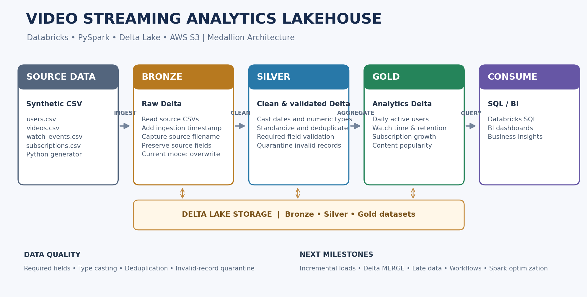

# Video Streaming Analytics Lakehouse

An end-to-end **Data Engineering portfolio project** built with **Databricks, PySpark, Delta Lake, Spark SQL, and AWS S3**. It applies the **Medallion Architecture** to transform synthetic video-streaming activity into analytics-ready datasets.

> **Status:** Initial batch ETL implementation. Incremental processing, orchestration, and performance optimization are planned milestones.

## Architecture



| Layer | Purpose | Main operations |
|---|---|---|
| **Bronze** | Store source data in Delta format | Read CSV files, add ingestion timestamp and source filename |
| **Silver** | Produce clean, validated datasets | Type casting, standardization, required-field checks, deduplication, invalid-record quarantine |
| **Gold** | Publish business-ready analytics | DAU, watch time, retention, subscription growth, content popularity |

## Business analytics

| Gold dataset | Description |
|---|---|
| `daily_active_users` | Distinct users with at least one valid watch event per day |
| `daily_watch_time` | Total watch time, average watch duration, and views per day |
| `viewer_retention` | Signup-cohort activity by days since signup |
| `subscription_growth` | Subscription starts, cancellations, and net event change per day |
| `content_popularity` | Views, unique viewers, and watch time by video |

**Metric definitions:** DAU is distinct users with at least one valid watch event per day. Watch time is the sum of valid watch durations. Viewer retention is active users in a signup cohort on a given day offset divided by cohort size. Subscription net change is starts minus cancellations; it is not a point-in-time subscriber balance.

## Source data

The generator creates four synthetic CSV files:

- `users.csv`: user profile and signup information
- `videos.csv`: content catalogue and metadata
- `watch_events.csv`: viewing events, timestamps, and watch duration
- `subscriptions.csv`: subscription lifecycle events

All data is synthetic and intended for learning and portfolio demonstration.

## Repository structure

```text
video-streaming-analytics-lakehouse/
├── README.md
├── .gitignore
├── requirements.txt
├── data/
│   └── README.md
├── docs/
│   └── architecture.png
├── scripts/
│   └── generate_sample_data.py
├── src/
│   ├── config.py
│   ├── pipeline.py
│   ├── ingestion/bronze_ingestion.py
│   ├── transformations/silver_transformations.py
│   ├── analytics/gold_aggregations.py
│   └── utils/data_quality.py
├── sql/analytics_queries.sql
└── tests/test_data_quality.py
```

## Getting started

### 1. Clone the repository

```bash
git clone https://github.com/<your-github-username>/video-streaming-analytics-lakehouse.git
cd video-streaming-analytics-lakehouse
```

### 2. Generate sample data

Use Python 3.9+:

```bash
python scripts/generate_sample_data.py --output-dir data/sample
```

This creates the four CSV files in `data/sample/`. Generated sample data is excluded from Git and can be recreated locally.

### 3. Open in Databricks

Import or clone this GitHub repository into Databricks Repos / Git folders. Use a Databricks Runtime that includes PySpark and Delta Lake.

### 4. Configure storage paths

The pipeline accepts two arguments:

- `source_path`: directory containing the four CSV files.
- `base_path`: root directory for Bronze, Silver, and Gold Delta datasets.

Example Unity Catalog Volume paths:

```text
/Volumes/<catalog>/<schema>/<volume>/sample
/Volumes/<catalog>/<schema>/<volume>/video_streaming_lakehouse
```

Example S3 paths:

```text
s3://<your-bucket>/video-streaming/sample
s3://<your-bucket>/video-streaming/lakehouse
```

Ensure Databricks compute has permission to read and write these paths. Use an IAM role, instance profile, Unity Catalog storage credential, or approved authentication method. **Never commit AWS keys or tokens.**

### 5. Run the pipeline

From a Databricks notebook opened at the repository root:

```python
from src.pipeline import run_pipeline

results = run_pipeline(
    spark=spark,
    source_path="/Volumes/<catalog>/<schema>/<volume>/sample",
    base_path="/Volumes/<catalog>/<schema>/<volume>/video_streaming_lakehouse"
)
print(results)
```

Replace the example paths with locations available in your workspace.

### 6. Query Gold data

```sql
SELECT event_date, daily_active_users
FROM delta.`<base_path>/gold/daily_active_users`
ORDER BY event_date;
```

See [`sql/analytics_queries.sql`](sql/analytics_queries.sql) for more examples.

## Data quality

Silver transformations include string standardization, type casting, required-field checks, positive duration checks, subscription event-type validation, deduplication, and quarantine of invalid rows with a quality flag and error reason.

## Current scope and limitations

This is an initial, reproducible **batch ETL** implementation:

- Bronze currently uses **overwrite** mode; it is not append-only or incremental yet.
- Silver and Gold datasets are rebuilt with overwrite mode on each run.
- Source watermarks, Delta `MERGE`, streaming ingestion, and late-arriving-event handling are not implemented yet.
- Data quality checks are foundational and can be extended with referential-integrity and business-rule checks.
- Partitioning, caching, file tuning, liquid clustering, and query-plan optimization are intentionally deferred until a working baseline exists.
- Retention is based on observed watch activity after signup, not predicted future retention.

## Roadmap

1. Add incremental ingestion using source watermarks.
2. Implement idempotent Delta `MERGE` logic and duplicate-safe reruns.
3. Handle late-arriving events and event-time reconciliation.
4. Expand data quality checks, metrics, and automated tests.
5. Orchestrate with Databricks Workflows.
6. Measure and optimize Spark workloads.
7. Build a Databricks SQL dashboard on Gold datasets.
8. Add CI checks for tests and code quality.

## Tech stack

**Databricks · PySpark · Spark SQL · Delta Lake · AWS S3 · Python · Git · GitHub**

## Disclaimer

Independent learning and portfolio project. The dataset is synthetic; this project is not affiliated with any streaming company.
